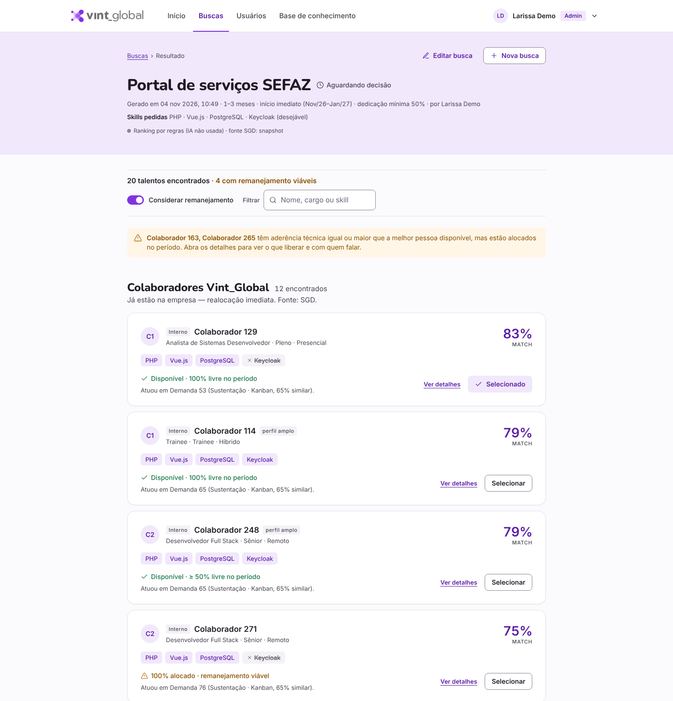

# VINT Match — alocação de talento (SGD + iHiring + IA)

App web no design **Vint_Global — Alocação de talento**: o gerente descreve o projeto (ou anexa o briefing), e em segundos
recebe o ranking de colaboradores do SGD e de talentos do iHiring, com disponibilidade mês a mês, histórico em projetos
parecidos, **remanejamento sugerido** (o que liberar e com quem falar) e **PDI**. Tem login, convites, perfis Admin/Usuário,
histórico de buscas e registro das decisões.



## Rodar (Windows)
```bat
cd C:\Users\minka\Documents\Hackathon_Vint
run.bat
```
Deixe a janela preta aberta: quando aparecer **“Servidor pronto”**, o navegador abre em http://127.0.0.1:8000 (se a 8000 estiver ocupada, usa 8001…). O registro fica em `logs/servidor.log`. **No primeiro acesso** a tela pede para criar o administrador (nome, e-mail
`@vintglobal.com`, senha forte). Depois, em **Usuários → Convidar usuário**, gere links de convite para o time.

> O e-mail ainda não é enviado: o convite/redefinição gera um link que você copia e manda pelo canal corporativo.
> Para aceitar outros domínios (demo), deixe `ALLOWED_EMAIL_DOMAIN=` vazio no `.env`.

Manual: `python -m venv .venv` → `.venv\Scripts\activate` → `pip install -r requirements.txt` → `python start_server.py`.

## Telas
| Rota | Tela |
|---|---|
| `#/login` | Login (bloqueio após 5 tentativas por 15 min) · primeiro uso cria o Admin |
| `#/primeiro-acesso?token=…` | Definir senha (convite) ou redefinir (link do Admin) |
| `#/` | Início: indicadores, “Descreva o projeto”, últimas decisões, buscas recentes |
| `#/buscas` · `#/buscas/nova` | Histórico do time · formulário (skills em chips, briefing PDF/DOCX, rascunho) |
| `#/buscas/:id` | Resultado: internos × iHiring, filtro, “considerar remanejamento”, seleção e confirmação |
| `#/buscas/:id/interno/:cid` | Detalhe: por que este match, alocações em linha do tempo, remanejamento sugerido + quem cobre, PDI |
| `#/usuarios` | Admin (pelo menu do usuário, à direita): convidar, reenviar convite, redefinir senha, bloquear/desbloquear |
| `#/perfil` | Dados, troca de senha, sessões ativas |
| `#/base` | Base de conhecimento: consulta **ao vivo** o SGD (skills, disponibilidade por mês, demandas, contratos, pessoas, totais), os projetos/alocações do app, o iHiring e os documentos (md, txt, pdf, docx — dá para enviar novos pela tela). Para a IA, pessoas viram “Colaborador 129”; a resposta volta com o nome real. |
| `/legado` | Interface anterior (uma página), útil como plano B |

Menu do usuário (à direita) → **Usuários** (Admin), **Meu perfil**, **Modo escuro** e **Sair**.

Buscas não se repetem: o app recusa um **nome de projeto igual** (ignora maiúsculas, acentos e pontuação) e o **mesmo arquivo de briefing** já usado em outra busca, com link para a existente. Um projeto aceita **várias pessoas**: selecione quantas quiser e confirme; depois dá para **adicionar mais** (em *Também sugeridos*), **ajustar a dedicação %** de cada uma ou **remover**. **Editar projeto** muda nome, descrição, skills e período e gera o ranking de novo — quem já está alocado continua no projeto.

## Configuração (`.env`)
**A IA é opcional.** Sem chave nenhuma (ou com `LLM_PROVIDER=none`) a extração do briefing, o ranking, o relatório e a
base de conhecimento funcionam só com as regras. O provedor definitivo será o que a VINT GLOBAL disponibilizar; trocar
de provedor é só mudar o `.env`, sem mexer no código. No protótipo usamos **Gemini** (principal) e **Groq** (reserva).

| Variável | Para quê |
|---|---|
| `GEMINI_API_KEY` / `GEMINI_MODEL` | IA (Gemini). Lê briefing, refina o ranking, escreve justificativa/PDI, responde a base. Aceita chaves `AIza…` e `AQ.…` (AI Studio ou Vertex AI modo express — o app descobre sozinho). Na subida, o app testa a IA e grava o motivo de qualquer falha em `logs/servidor.log` e em http://127.0.0.1:8000/api/ia/status. |
| `GROQ_API_KEY` / `GROQ_MODEL` | **Reserva automática** (grátis em console.groq.com): se o Gemini falhar (ex.: 503 “alta demanda”), a mesma chamada vai para o Groq. |
| `ANTHROPIC_API_KEY` / `LLM_PROVIDER` | Claude (opcional); `LLM_PROVIDER=auto|gemini|groq|claude|none` define o principal — os outros com chave viram reserva. |
| `GROQ_BASE_URL` | Endereço do serviço no formato da API da OpenAI (padrão: Groq). Trocando URL, chave e modelo, entra **qualquer provedor compatível** — inclusive um modelo interno da VINT. |
| `DATABASE_URL` | Postgres do hackathon (somente leitura). Sem ele, usa `data/sgd_snapshot.sqlite`. |
| `APP_DB_PATH` | Banco do app (usuários, sessões, buscas, decisões). Padrão `data/app.db`. |
| `ALLOWED_EMAIL_DOMAIN` | Domínio exigido em login/convite (padrão `vintglobal.com`; vazio = qualquer). |
| `REFERENCE_MONTH` | “Hoje” para disponibilidade (`AAAA-MM`). |
| `MCP_MOSTRAR_NOMES` | Cursor/MCP: `0` pseudonimiza nomes. |

## Dados e segurança
- **SGD é só leitura** (sessão Postgres `read_only` ou SQLite `immutable`). O que o app cria (usuários, buscas, decisões)
  fica em `data/app.db`, **outro arquivo**. Teste `test_somente_leitura` garante isso.
- Senhas com PBKDF2-SHA256; sessão em cookie `httpOnly`/`SameSite=Lax`; tokens de convite com validade de 48 h e uso único.
- Nenhum nome vai para a IA (pseudônimos C1, C2…) nem para os logs.
- Talentos iHiring e briefings de `docs/exemplos/` são **sintéticos** e marcados na tela.

## Estrutura
```
app/main.py      rotas (auth, usuários, perfil, buscas, decisões, detalhe, extract, rag)
app/auth.py      senhas, sessões, convites, bloqueio      app/store.py   banco do app (SQLite)
app/buscas.py    busca → matching → histórico/decisões/detalhe/dashboard
app/matching.py  score, remanejamento, PDI                 app/sgd.py     SGD em memória (somente leitura)
app/llm.py       IA opcional (Gemini/Groq/Claude)          app/extract.py PDF/DOCX → requisitos
app/rag.py       base de conhecimento                      app/static/    SPA (index.html, spa.js, app.css, vint.css, fontes, logo)
mcp_server.py    ferramentas para o chat do Cursor         tests/         pytest: unidades, smoke, api, cenário do José
```

## Testes
51 testes automatizados (pytest), cobertura de 87% do pacote `app`. Nenhum teste chama a internet nem grava no
`data/app.db` real (ver `tests/conftest.py`).
```bash
pip install -r requirements-dev.txt   # pytest e pytest-cov
python -m pytest                      # roda tudo
python -m tests.gerar_relatorio       # roda tudo com cobertura e grava as evidências em docs/testes/
```
| Arquivo | Tipo | O que cobre |
| --- | --- | --- |
| `tests/test_unidades.py` | Unitário (37) | datas e duração livres, níveis, normalização, PDI, remanejamento, externos, prévia, IA em pausa |
| `tests/test_smoke.py` | Componente (10) | somente leitura, carga do SGD, matching, extração, DOCX, RAG, IA simulada e provedor reserva |
| `tests/test_api.py` | Ponta a ponta (1 fluxo, 73 verificações) | setup → busca → prévia → duplicidade → alocação → relatório → convite → bloqueio → base |
| `tests/test_cenario_jose.py` | Aceite e desempenho (3) | o pedido do slide (Node.js + AWS, Sênior, 50%, 3 meses) e o tempo do cruzamento das bases |

Evidências da última execução: `docs/testes/RELATORIO_TESTES.md`, `execucao.txt`, `junit.xml` e `cobertura/index.html`.
Os testes antigos também rodam sem pytest: `python -m tests.test_smoke` e `python -m tests.test_api`.
O que ainda falta para produção está em **PENDENCIAS.md**.
